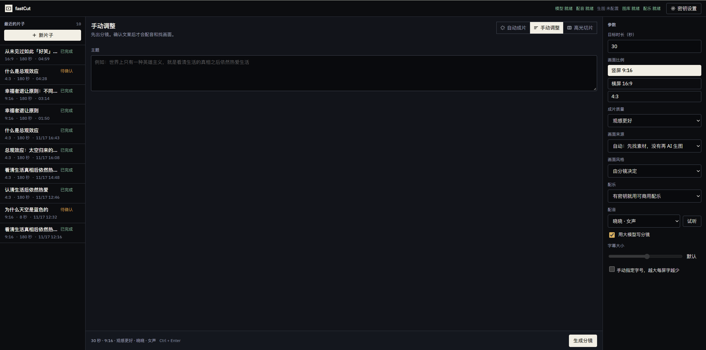
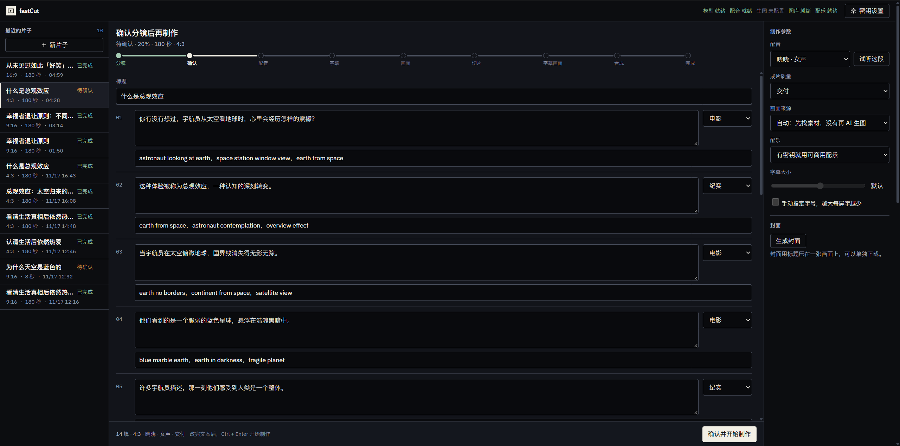
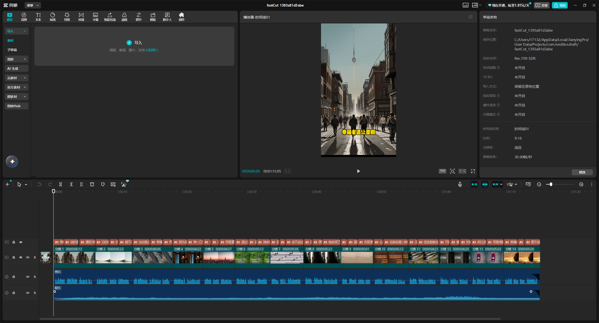

# fastCut

fastCut 是一个本地运行的自动剪辑工具。输入一句话主题，它会写分镜、配音、找画面、压字幕并合成成片；也可以上传一条长视频，按目标时长切出高光。成片是 mp4，同时会生成剪映 / CapCut 草稿，画面、旁白、字幕和配乐分在不同轨道上，可以继续改。

密钥不写在仓库里。模型、配音、生图、图库和配乐的 Key 都在网页右上角「密钥设置」里填写，保存在本机的 `config/local.json`。

## 界面

手动调整：先写主题和制作参数，再生成分镜。



确认分镜后再制作。每一镜可以改旁白、画面关键词和风格，确认后才会配音、找画面并合成。



本机装了剪映或 CapCut 时，草稿会写进软件的草稿列表。打开后是一条竖屏时间线：上面是分镜画面，中间是旁白，下面是配乐，字幕已经压在画面上。



## 功能

网页左侧是最近的片子，中间是工作区，右侧是这一条片子的参数。顶栏会显示模型、配音、生图、图库和配乐是否已经配好密钥。

三种做法：

- **自动成片**。写清主题、时长和风格，直接生成。模型会把这句话整理成时长、比例、画质、音色、画面来源和是否配乐。没配大模型时，用本地规则做同样的整理。
- **手动调整**。先出分镜。可以勾选「先确认分镜，再开始制作」，停在文案上改完再往下走。不勾选则理解完主题就直接配音、找画面并合成。
- **高光切片**。上传本地视频，或填一个 http(s) 地址。按成片时长从原片里挑片段，比例只影响导出的画面。

一条片子会经过这些步骤：分镜、确认、配音、字幕、画面、切片、字幕画面、合成。制作过程中可以停止，停完回到分镜，已经写好的文案还在。

成片之外还有：

- **可编辑草稿**。分镜、旁白、配乐和字幕拆成剪映轨道。本机装了剪映专业版或 CapCut 时，草稿注册进软件的草稿目录；同时提供 zip，可以下载后手动导入。
- **封面**。标题压在一张画面上，可以单独下载。
- **配音试听**。在参数里选音色后可以直接试听。
- **字号**。默认字号，也可以把字幕调到大约 48 到 140。
- **任务列表**。最近的片子留在左侧，可以重新打开、删除，或下载成片。

时长限制是 5 到 180 秒。默认 30 秒。画面比例：

| 比例 | 成片尺寸 |
| --- | --- |
| 竖屏 9:16 | 1080×1920 |
| 横屏 16:9 | 1920×1080 |
| 4:3 | 1440×1080 |

帧率 30fps。检测到 NVIDIA、Intel、AMD 硬件编码器时用硬件编码，否则用 x264。

画面来源：

| 选项 | 行为 |
| --- | --- |
| 自动 | 先找视频或图库素材，没有再 AI 生图 |
| 网络图片 | Unsplash / Pexels，也会用到 Pixabay |
| 只要视频素材 | 只用视频素材 |
| AI 生图 | 用密钥设置里选的远程生图模型 |
| 本地 Stable Diffusion | 调用本机 SD WebUI |

画面风格可以指定电影、纪实、明亮，也可以留给分镜自己决定。配乐默认是「有密钥就用可商用配乐」；也可以强制走 Freesound，或关掉网络配乐。Freesound 检索只带 CC0 和 CC BY。

成片质量交给画面渲染：

| 质量 | 用途 |
| --- | --- |
| 草稿 | 速度优先，默认 |
| 观感更好 | 画面更细 |
| 交付 | 用于导出的成片 |

字幕优先用 HyperFrames 渲染。本机没有 `npx`，或渲染失败时，改用 ASS 字幕烧进画面。

## 支持的模型

在「密钥设置」里按厂商选择。换厂商时，各自的密钥会分开记住。列表里没有的模型，可以选自定义并填写兼容接口地址。

### 大模型

用来写分镜、理解主题，以及从长视频里挑高光。除 Claude 走 Anthropic 官方接口外，其余都走 OpenAI 兼容的 `/chat/completions`。

| 厂商 | 默认模型 | 还可以选 |
| --- | --- | --- |
| DeepSeek | `deepseek-chat` | `deepseek-reasoner` |
| 通义千问 | `qwen-plus` | `qwen-turbo`、`qwen-max`、`qwen-long` |
| 智谱 GLM | `glm-4-flash` | `glm-4-air`、`glm-4-plus`、`glm-4.5` |
| Kimi | `moonshot-v1-auto` | `moonshot-v1-8k`、`moonshot-v1-32k`、`kimi-latest` |
| 豆包 | 火山方舟接入点 ID | 填写 `ep-` 开头的接入点 |
| 硅基流动 | `deepseek-ai/DeepSeek-V3` | Qwen2.5 72B、GLM-4 9B |
| MiniMax | `MiniMax-Text-01` | `MiniMax-M1` |
| 阶跃星辰 | `step-2-mini` | `step-2-16k` |
| 百度千帆 | `deepseek-v3` | 文心 4.0 Turbo、文心 Speed |
| OpenAI | `gpt-4o-mini` | `gpt-4o`、`gpt-4.1-mini`、`gpt-4.1` |
| Claude | `claude-sonnet-4-5` | `claude-haiku-4-5`、`claude-opus-4-1` |
| Gemini | `gemini-2.5-flash` | `gemini-2.5-pro`、`gemini-2.0-flash` |
| Grok | `grok-3` | `grok-4`、`grok-3-mini` |
| Groq | `llama-3.3-70b-versatile` | `llama-3.1-8b-instant` |
| Mistral | `mistral-small-latest` | `mistral-large-latest` |
| OpenRouter | `openai/gpt-4o-mini` | Claude Sonnet 4.5、DeepSeek Chat，也可填平台上的其他模型名 |
| 自定义接口 | 自填 | 任何以 `/v1` 结尾、兼容 OpenAI Chat Completions 的地址 |

不调用大模型时，本地导演仍能按主题写出分镜。网页里取消「用大模型写分镜」，或命令行加上 `--no-llm`。

### 配音

微软 Edge 免费，不用密钥。国内网络有时连不上微软语音服务。其他厂商没填密钥时，成片会改用 Edge。

| 厂商 | 默认模型 | 音色 |
| --- | --- | --- |
| 微软 Edge | 无 | 晓晓、晓伊、云希、云健、云扬 |
| MiniMax 语音 | `speech-02-turbo`、`speech-02-hd` | 少女、御姐、成熟女声、青涩男声、精英男声、女播音、男播音 |
| 通义语音 | Sambert | 知初、知妙、知燕、知楠、知琪 |
| 硅基流动 CosyVoice | `FunAudioLLM/CosyVoice2-0.5B` | Alex、Anna、Bella、Benjamin、Claire、David |
| OpenAI | `tts-1`、`tts-1-hd`、`gpt-4o-mini-tts` | Alloy、Echo、Fable、Onyx、Nova、Shimmer |
| ElevenLabs | `eleven_multilingual_v2`、`eleven_turbo_v2_5` | Rachel、Bella、Elli、Adam、Antoni、Josh，也可填自定义音色 ID |
| Fish Audio | `s1`、`speech-1.5` | 默认音色；克隆音色把 reference id 填进自定义音色 ID |

### 文生图

不选远程生图时，找不到图库素材仍会试本地 Stable Diffusion。连不上 SD WebUI 就退回色块画面。

| 厂商 | 默认模型 | 还可以选 |
| --- | --- | --- |
| 不使用 | 无 | 只走素材库和本地 SD |
| 通义万相 | `wanx2.1-t2i-turbo` | `wanx2.1-t2i-plus`、`wanx-v1` |
| 智谱 CogView | `cogview-3-flash` | `cogview-4` |
| 硅基流动 | `black-forest-labs/FLUX.1-schnell` | 可图 Kolors、SD 3.5 Large |
| OpenAI | `dall-e-3` | `dall-e-2`、`gpt-image-1` |
| Stability | Stable Image Core | SD 3.5 Large |
| 自定义接口 | `dall-e-3` | 兼容 OpenAI `images/generations` 的完整地址 |

### 素材与配乐

这些也在密钥设置里填。Pexels、Pixabay 可以填多个 Key，用英文逗号分隔，限流时自动换下一个。

| 服务 | 用途 |
| --- | --- |
| Pexels | 视频和图片素材 |
| Pixabay | 视频和图片素材 |
| Unsplash | 图片素材 |
| Freesound | CC0 / CC BY 配乐 |

### 本地 Stable Diffusion

可选。启动 SD WebUI 时加上 `--api`，默认地址是 `http://127.0.0.1:7860`。默认模型名 `REALISTIC_COMIC_BOOK`，步数 20，CFG 7，采样器 `Euler a`。宽高为 0 时按成片比例出图。这些写在 `.env`，见 `.env.example`。

## 技术栈

| 层 | 使用 |
| --- | --- |
| 接口 | Python 3.10+、FastAPI、Uvicorn、Pydantic |
| 网页 | Vue 3、Vite。开发时跑在 5173，并把 `/config`、`/tasks`、`/voices` 代理到 8000 |
| 成片 | FFmpeg、FFprobe。自动选择 NVENC、QSV、AMF、VideoToolbox 或 x264 |
| 配音 | edge-tts，以及其他厂商的 HTTP 接口 |
| 字幕与画面 | HyperFrames（通过 `npx` 调用）。失败时用 ASS 烧录 |
| 草稿 | 剪映 / CapCut 的明文草稿格式（`draft_content.json`） |
| 配置 | python-dotenv。网页保存的密钥在 `config/local.json`，优先级高于 `.env` |

可选依赖，不装也能跑：

- `faster-whisper`：字级时间轴更准。没装时按字数分摊时间戳。对齐方式还可以指定 `auto`、`estimate`、`faster-whisper`、`hyperframes`。
- `open_clip_torch` 和 `torch`：把素材和旁白做语义过滤。`.env` 里 `CLIP_ENABLE=1` 才会启用。
- 本机的 Stable Diffusion WebUI、剪映专业版或 CapCut。

## 如何运行

需要先装好：

1. [Python 3.10+](https://www.python.org/downloads/)，并加入 PATH。
2. [Node.js](https://nodejs.org/)，网页开发和 HyperFrames 字幕都要用到 `npm` / `npx`。
3. [FFmpeg](https://ffmpeg.org/)，命令行里能直接运行 `ffmpeg` 和 `ffprobe`。装在其他位置时，在 `.env` 里设置 `FFMPEG_BIN` 和 `FFPROBE_BIN`。

### Windows 一键打开

双击项目根目录的 `启动界面.bat`。它会：

1. 在 8000 端口启动接口：`python main.py serve --host 127.0.0.1 --port 8000`
2. 在 `frontend` 里安装依赖并启动 Vite：`http://127.0.0.1:5173`
3. 打开浏览器

端口已经在听时不会重复启动。90 秒内起不来，看弹出的「fastCut API」和「fastCut Web」窗口里的报错。

### 手动启动

```bash
python -m venv .venv
```

Windows：

```bat
.venv\Scripts\activate
pip install -r requirements.txt
copy .env.example .env
cd frontend
npm install
npm run dev
```

另开一个终端，在项目根目录：

```bat
.venv\Scripts\activate
python main.py web
```

`web` 会启动接口并打开浏览器。只启动接口、不打开浏览器用 `python main.py serve`。

开发时用 `http://127.0.0.1:5173`。`npm run build` 会把页面构建到 `web/dist`，之后只跑 `python main.py web` 也会从 8000 端口直接打开构建好的页面。

macOS / Linux 把激活命令换成 `source .venv/bin/activate`，复制环境文件用 `cp .env.example .env`。

### 填写密钥

打开网页后点右上角「密钥设置」：

1. 选大模型厂商，填写 API Key 和模型。国内可直接用的包括 DeepSeek、通义、智谱、Kimi、硅基流动。
2. 配音保持「微软 Edge」就可以免费出声。要换 MiniMax、通义、OpenAI 等再填对应 Key。
3. 需要图库素材时填 Pexels、Pixabay 或 Unsplash。需要配乐时填 Freesound。
4. 需要远程生图时再选通义万相、CogView、硅基流动、OpenAI 或 Stability。

保存后密钥写在 `config/local.json`。这个文件已在 `.gitignore` 里，不会进仓库。接口只回传密钥的末尾提示，不回传完整 Key。换厂商再换回来，之前填过的 Key 还在。

`.env` 只放非密钥的默认项，例如 SD WebUI 地址、默认音色、缓存保留时间。`.env` 同样不提交。

### 命令行

从主题生成：

```bash
python main.py run --topic "为什么天空是蓝色的" --duration 30 --aspect 9:16
```

从长视频切高光：

```bash
python main.py highlight --video "D:\footage\talk.mp4" --duration 30 --aspect 9:16
```

常用参数：

| 参数 | 说明 |
| --- | --- |
| `--duration` | 5 到 180 秒，默认 30 |
| `--aspect` | `9:16`、`16:9`、`4:3` |
| `--voice` | Edge 音色名，默认 `zh-CN-XiaoxiaoNeural` |
| `--bgm` | 本地背景音乐文件 |
| `--quality` | `draft`、`looks`、`delivery` |
| `--align` | `auto`、`estimate`、`faster-whisper`、`hyperframes` |
| `--no-llm` | 不调用大模型 |

清理超过保留时间的任务目录和素材缓存，默认 24 小时：

```bash
python main.py cleanup --hours 24
```

## 目录

```
fastCut/
├── main.py              命令行入口
├── api.py               网页和 HTTP 接口
├── 启动界面.bat          Windows 一键启动
├── requirements.txt
├── .env.example         环境变量模板，不含密钥
├── config/              厂商列表、编码参数、本机配置读写
├── core/                分镜、配音、素材、合成、剪映草稿
├── frontend/            Vue 3 页面
├── web/dist/            构建后的页面，由 8000 端口直接提供
├── docs/                README 里的截图
├── workspace/           每条片子的分镜、音频和草稿，不提交
└── output/              成片 mp4，不提交
```

`workspace/` 和 `output/` 只保留空目录。片子、缓存、日志和成片都留在本机。

## 测试

```bash
pip install -r requirements.txt
pytest
```

测试覆盖分镜整理、配置保存和网页接口。密钥在测试里使用的是假值。
